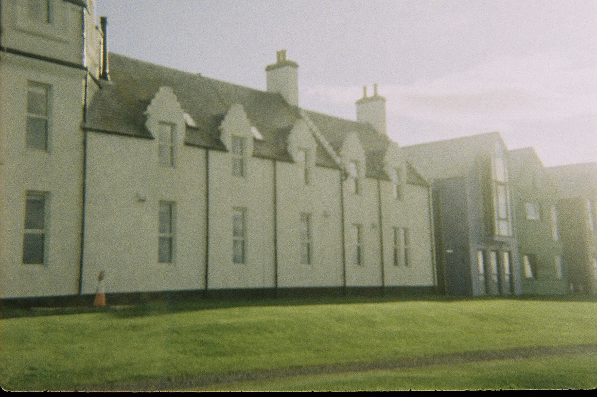
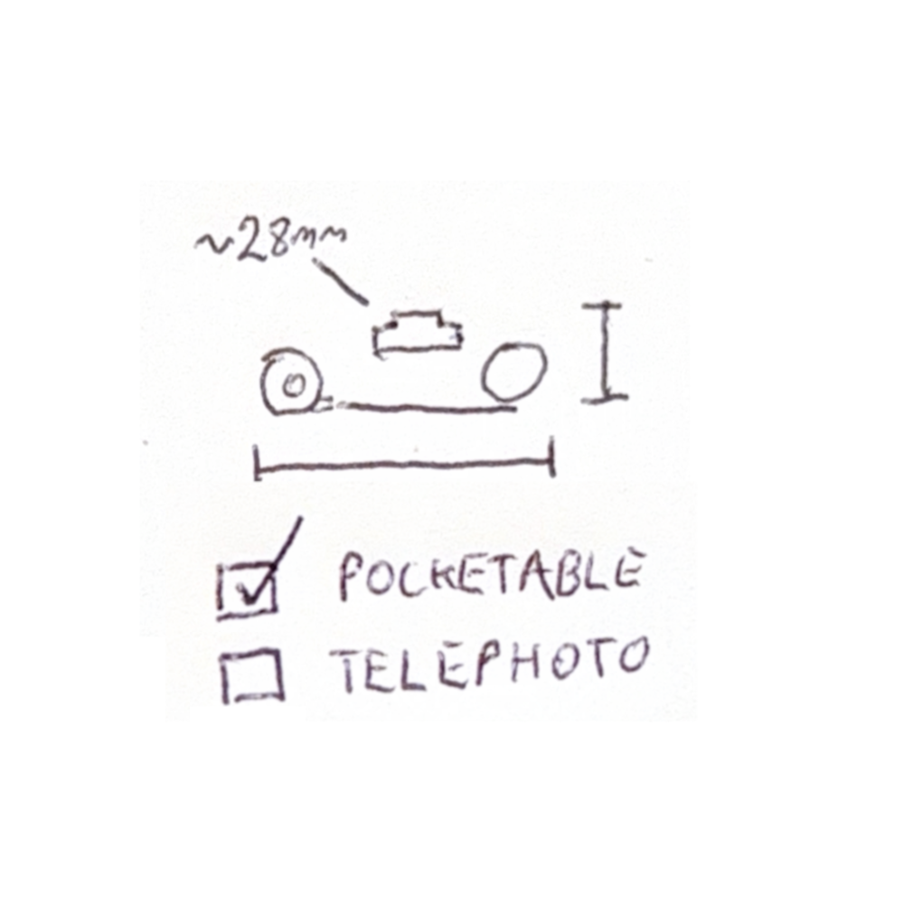
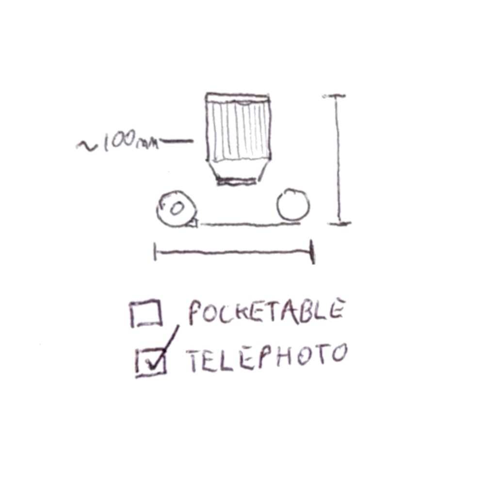
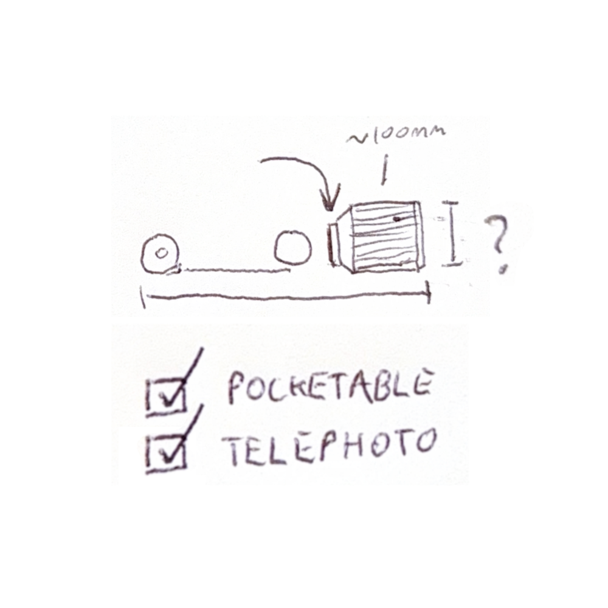

I love taking photos, but I really dislike carrying stuff around. My Nikon F3 is my favourite object on earth - but, I came to love point and shoots like my Canon Sureshot 76 ($4 NZD) and Agfa Pocket 2000 ($18 NZD).

That these cameras were so portable was truly awesome. The Canon's zoom lens was sharp and let me place a full 35mm frame wherever I wanted. The telescoping zoom lens was slow, and eventually broke. Only the Agfa was truly pocketable, and that shot 110 film.

I wanted to see if I could source a camera that was as pocketable as the Agfa but as versatile as the Canon. I was not able to find one.

The main constraint here is that with long focal lengths (zoom) comes large physical dimensions. Coarsely speaking, telephoto lenses need to be long to provide magnification.

Most camera mechanisms have the film canister and takeup spool intersecting the image plane, which results in cameras having that T-shape you expect. Unless you have a very short lens - almost flush with the camera body, your camera will not fit in your pocket.

  
  

I wondered if it would be possible to build a camera to have the film canister and takeup spool located behind the image plane. That way longer focal lengths could be accommodated without affecting pocketability.

  

Obviously the above layout wouldn't work - the image would be projected onto the takeup spool. However, relocating the film plane is a much more tractable problem than shrinking a telephoto lens. I decided I'd have a crack at developing such a camera.

After a long few months prototyping, I arrived at this.

I designed and printed a chassis and the lateral transport system, but borrowed the lens from a used Kodak FunSaver disposable, and got a shutter mechanism from Amazon.

I was quite paranoid about light leaks, so walls were made 2mm thick and a shoulder was printed into each mating point in the chassis. This was heavy-handed. The whole assembly could be made much more compact with some tuning of these features.

I took this camera, along with my F3, up to Scotland with my friend Harry to ride the North Coast 500. To be clear, I wasn't even sure if it would work. Light might leak in constantly, the shutter might drag or get stuck, the film might tear, the lens mightn't be positioned to get correct focus on the film plane, etc etc., Here the camera shot its only roll before being decommissioned.